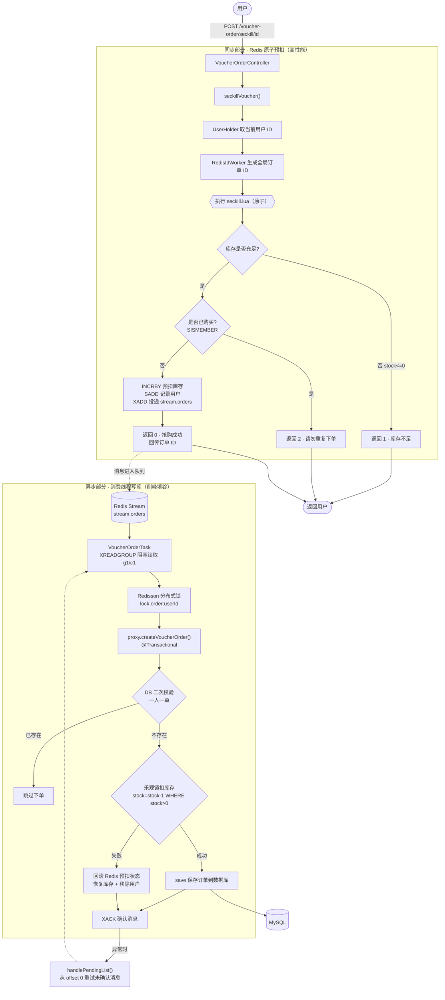

# HCFS · 高并发优惠券秒杀系统

> 基于 **Spring Boot + Redis** 的点评/秒杀实战项目（黑马点评 hm-dianping 演进版），围绕 Redis 的多种数据结构与高并发场景，完整实现了登录认证、缓存治理、分布式锁、异步秒杀、社交 Feed 流、GEO 附近商铺、签到统计等经典功能。

---

## 一、项目简介

本项目是一个以 **Redis 实战** 为核心的后端服务，业务背景为「本地生活点评 + 优惠券秒杀」。项目在标准分层架构基础上，针对高并发读写场景做了大量 Redis 侧的优化设计，涵盖：

- **缓存三大问题**（穿透 / 击穿 / 雪崩）的通用封装解决方案
- **分布式锁**（自研 + Redisson）
- **全局唯一 ID 生成器**
- **基于 Lua + Redis Stream 的异步秒杀**（一人一单、库存预扣、消息可靠投递）
- **社交功能**（点赞排行、关注、共同关注、Feed 流推模式 + 滚动分页）
- **GEO 附近商铺**、**BitMap 签到统计**

---

## 二、技术栈

| 分类 | 技术选型 | 版本 |
| --- | --- | --- |
| 基础框架 | Spring Boot | 2.7.18 |
| 开发语言 | Java | 1.8（可在 JDK 17 运行） |
| 持久层 | MyBatis-Plus | 3.5.2 |
| 数据库 | MySQL（mysql-connector-java） | 5.1.47 |
| 缓存 / 消息 | Redis（Lettuce 连接池） | - |
| 分布式锁 | Redisson | 3.13.6 |
| 工具库 | Hutool | 5.7.17 |
| 接口文档 | Knife4j (OpenAPI3) | 4.1.0 |
| 简化代码 | Lombok | - |
| AOP | AspectJ Weaver | - |

---

## 三、环境要求

- **JDK** 1.8+（推荐 17）
- **Maven** 3.6+
- **MySQL** 5.7+，需创建数据库 `hcfs`
- **Redis** 5.0+（需支持 Stream 数据结构）
- **Docker / Docker Compose**（可选，用于一键拉起 MySQL 与 Redis）
- **JMeter** 5.x（可选，用于秒杀接口压力测试）

---

## 四、快速开始

### 1. 克隆项目

```bash
git clone https://github.com/G-W7/High-Concurrency-Coupon-Flash-Sale-System.git
cd hm-dianping
```

### 2. 启动 MySQL 与 Redis

**方式一：Docker Compose 一键启动（推荐）**

```bash
docker compose up -d
```

将自动拉起 `mysql:5.7`（容器 `hcfs-mysql`，首次启动自动建库并执行初始化脚本）与 `redis:7-alpine`（容器 `hcfs-redis`，开启 AOF 持久化），端口分别映射到本机 `3306` / `6379`，root 密码为 `123456`（与 `application.yaml` 保持一致）。

**方式二：本地已有环境**

手动导入 SQL 脚本（位于 `src/main/resources/db/hcfs.sql`）到 MySQL，创建 `hcfs` 数据库及相关表。

> 脚本中 `tb_seckill_voucher` 的 `begin_time` / `end_time` 默认值为 `NULL`，兼容 MySQL 5.7+ 的 `NO_ZERO_DATE` 严格 SQL 模式。

### 3. 修改配置

编辑 `src/main/resources/application.yaml`，按本地环境调整数据库与 Redis 连接：

```yaml
server:
  port: 8081
spring:
  datasource:
    url: jdbc:mysql://localhost:3306/hcfs?useSSL=false
    username: root
    password: 123456
  redis:
    host: localhost
    port: 6379
```

> Redisson 连接地址在 `config/RedissonConfig.java` 中配置，如 Redis 有密码或非默认地址请一并修改。

### 4. 启动项目

```bash
# 方式一：Maven 命令
mvn spring-boot:run

# 方式二：打包后运行
mvn clean package
java -jar target/hcfs-0.0.1-SNAPSHOT.jar
```

启动类为 `com.hcfs.HCFSApplication`。

### 5. 访问接口文档

项目集成了 Knife4j，启动后访问：

- Knife4j 文档：<http://localhost:8081/doc.html>
- Swagger UI：<http://localhost:8081/swagger-ui.html>

---

## 五、项目结构

```
hm-dianping
└── src/main/java/com/hcfs
    ├── HCFSApplication.java        # 启动类
    ├── config                      # 配置类
    │   ├── Knife4jConfig.java      # 接口文档配置
    │   ├── MvcConfig.java          # 拦截器注册
    │   ├── MybatisConfig.java      # MyBatis-Plus 配置
    │   ├── RedissonConfig.java     # Redisson 客户端
    │   └── WebExceptionAdvice.java # 全局异常处理
    ├── controller                  # 控制层（REST 接口）
    ├── service / service.impl      # 业务逻辑层
    ├── mapper                      # 数据访问层（MyBatis-Plus）
    ├── entity                      # 数据库实体
    ├── dto                         # 数据传输对象（Result / UserDTO / LoginFormDTO / ScrollResult）
    └── utils                       # 工具类
        ├── CacheClient.java        # 通用缓存工具（穿透/击穿/雪崩封装）
        ├── RedisIdWorker.java      # 全局唯一 ID 生成器
        ├── ILock.java / LockImpl.java  # 自研分布式锁
        ├── RedisConstants.java     # Redis Key 与 TTL 常量
        ├── RedisData.java          # 逻辑过期数据封装
        ├── LoginIntercepter.java   # 登录校验拦截器
        ├── RefreshTokenIntercepter.java # Token 刷新拦截器
        └── UserHolder.java         # ThreadLocal 用户上下文
└── src/main/resources
    ├── application.yaml
    ├── seckill.lua                 # 秒杀原子操作脚本
    ├── unlock.lua                  # 分布式锁释放脚本
    ├── mapper/VoucherMapper.xml
    └── db/hcfs.sql                 # 数据库初始化脚本
├── docker-compose.yml              # MySQL 5.7 + Redis 7 一键启动
└── jmeter                          # 秒杀接口压测工具包（见「八、性能压测」）
    ├── prepare_data.ps1            # 压测数据预热（token / 库存）
    ├── smoke_test.ps1              # 秒杀接口冒烟测试
    ├── cleanup.ps1                 # 压测数据清理
    ├── seckill.jmx                 # 秒杀接口压测计划
    ├── shop_cache.jmx              # 商铺缓存接口压测计划
    ├── tokens.csv                  # 参数化 token（压测时自动生成）
    └── report_html/                # JMeter HTML 压测报告
```

---

## 六、核心功能模块

### 1. 登录认证（双拦截器 + Redis Token）

采用「短信验证码 + Redis Token」的无状态登录方案，并通过 **双拦截器链** 实现 Token 自动续期与鉴权分离：

- `RefreshTokenIntercepter`（order=0）：拦截所有请求，刷新 Token 有效期，并将用户信息存入 `ThreadLocal`（`UserHolder`）。
- `LoginIntercepter`（order=1）：仅拦截需登录的路径，校验 `ThreadLocal` 中是否存在用户。
- 请求结束后在 `afterCompletion` 中清理 `ThreadLocal`，防止内存泄漏。

用户信息以 **Hash** 结构存储于 `login:token:{uuid}`，验证码存储于 `login:code:{phone}`。

### 2. 缓存治理（CacheClient 通用封装）

`CacheClient` 以泛型 + 函数式接口封装了三类缓存问题的解决方案：

| 问题 | 方案 | 方法 |
| --- | --- | --- |
| 缓存穿透 | 缓存空值（短 TTL） | `queryWithPassThrough` |
| 缓存击穿 | 互斥锁串行重建缓存 | `queryWithMutex` |
| 缓存击穿 | 逻辑过期 + 异步重建 | `queryWithLogicalExpire` |
| 缓存雪崩 | TTL 增加随机值 | 封装于各缓存写入方法 |

商铺缓存（`cache:shop:`）、商铺类型缓存（`cache:shop:type:`）均基于该工具类实现。

### 3. 分布式锁

- **自研锁**（`ILock` / `LockImpl`）：基于 Redis `SET NX` + Lua 脚本（`unlock.lua`）实现，保证「判断标识 + 释放锁」的原子性，避免误删他人锁。
- **Redisson 锁**：用于秒杀异步下单场景，以用户 ID 为粒度加锁，保证同一用户订单串行处理。

### 4. 全局唯一 ID 生成器（RedisIdWorker）

基于 Redis `INCR` 自增实现，ID 结构为：**1 位符号位 + 31 位时间戳（秒）+ 32 位序列号**，兼具全局唯一、趋势递增、高性能特性。Key 按天拆分（如 `icr:order:2026:11:02`）以便统计。

### 5. 异步秒杀（Lua + Redis Stream）⭐核心

秒杀采用「同步预扣 + 异步下单」架构，是本项目最核心的高并发设计：

**同步部分**（`seckillVoucher`）：通过 `seckill.lua` 在 Redis 中 **原子性** 完成：
1. 校验库存是否充足（不足返回 `1`）
2. 校验一人一单（重复返回 `2`）
3. 预扣库存（`INCRBY -1`）
4. 记录用户到已购集合（`SADD`）
5. 投递订单消息到 Stream（`XADD stream.orders`）
6. 成功返回 `0`，并返回预生成的全局订单 ID

**异步部分**（`VoucherOrderTask` 消费线程）：
- 单线程池持续从 Stream 消费者组 `g1` 阻塞读取消息（`XREADGROUP`）。
- 通过 Redisson 分布式锁 + `@Transactional` 事务方法 `createVoucherOrder` 写入数据库：二次校验一人一单 → 乐观锁扣减数据库库存（`WHERE stock > 0`）→ 保存订单。
- 处理成功后手动 `ACK` 确认；异常时进入 **Pending List 重试**（从 offset `0` 重读未确认消息），实现「至少一次」消费语义。
- 若数据库扣减失败，回滚 Redis 预扣状态，保证最终一致性。

> 通过 `@Lazy` 自注入获取 AOP 代理对象 `proxy`，确保异步线程中调用事务方法时 `@Transactional` 生效；`@PostConstruct` 中初始化 Stream 与消费者组，避免 `NOGROUP` 错误。

**秒杀链路架构图（同步预扣 + 异步下单）：**



### 6. 社交功能（点赞 / 关注 / Feed 流）

- **点赞**：以 **ZSet**（`blog:liked:{id}`，score=时间戳）实现点赞排行与去重，返回 Top N 点赞用户。
- **关注 / 共同关注**：以 **Set**（`follows:{userId}`）存储关注列表，共同关注通过 `SINTER` 求交集实现。
- **Feed 流**：采用 **推模式（写扩散）**，发布博客时将博客 ID 推送到所有粉丝的收件箱 ZSet（`feed:{userId}`，score=时间戳）；滚动分页使用 `ZREVRANGEBYSCORE` 配合 `minTime` 与 `offset`，解决动态数据的重复/漏读问题（结果封装于 `ScrollResult`）。

### 7. GEO 附近商铺

将商铺经纬度以 **GEO** 结构（`shop:geo:{typeId}`）存入 Redis，支持按类型查询附近商铺并按距离排序。

### 8. 签到统计（BitMap）

以 **BitMap**（`sign:{userId}:{yyyyMM}`）记录每日签到，每个 bit 表示一天；支持统计连续签到天数等。

---

## 七、Redis 数据结构映射

| 数据结构 | 应用场景 |
| --- | --- |
| **String** | 缓存 JSON、验证码、分布式锁、秒杀库存、全局 ID |
| **Hash** | 登录用户 Token 信息、商铺类型列表 |
| **Set** | 一人一单已购集合、关注列表、共同关注（交集） |
| **ZSet** | 点赞排行（按时间）、Feed 流收件箱（score=时间） |
| **BitMap** | 用户签到记录（按月，每天一个 bit） |
| **GEO** | 附近商铺按距离检索 |
| **Stream** | 秒杀异步订单消息队列（消费者组 + Pending List） |

---

## 八、性能压测（JMeter）

项目内置了一套针对秒杀链路的 JMeter 压测工具包（位于 `jmeter/` 目录），配套 PowerShell 脚本完成数据准备与清理：

| 文件 | 用途 |
| --- | --- |
| `prepare_data.ps1` | 通过 `hcfs-redis` 容器内的 redis-cli 批量写入虚拟登录 token（`login:token:{uuid}`）与秒杀库存（`seckill:stock:{voucherId}`），并导出 `tokens.csv` 供 JMeter 参数化使用；无需在 MySQL 中真实创建用户即可跑通秒杀链路 |
| `smoke_test.ps1` | 用 `tokens.csv` 中的真实 token 发起一次秒杀请求，验证鉴权与库存是否就绪 |
| `seckill.jmx` | 秒杀接口（`POST /voucher-order/seckill/{id}`）压测计划 |
| `shop_cache.jmx` | 商铺缓存接口（`GET /shop/{id}`）压测计划 |
| `cleanup.ps1` | 清理压测写入 Redis 的 token、库存、一人一单记录及 `stream.orders`，便于重复压测（不删除 MySQL 已落库订单） |
| `report_html/` | JMeter HTML 压测报告 |

**典型压测流程：**

```powershell
cd jmeter

# 1. 预热数据（默认 200 个 token、优惠券 id=10、库存 100000）
powershell -ExecutionPolicy Bypass -File .\prepare_data.ps1

# 2. 冒烟测试，确认链路就绪
powershell -ExecutionPolicy Bypass -File .\smoke_test.ps1

# 3. 执行 JMeter 压测并生成 HTML 报告
jmeter -n -t .\seckill.jmx -l .\result.jtl -e -o .\report_html

# 4. 压测结束后清理 Redis 测试数据
powershell -ExecutionPolicy Bypass -File .\cleanup.ps1
```

> 注意：`prepare_data.ps1` 生成的 token 数量需 ≥ JMeter 线程组的线程数；token 默认 TTL 为 2 小时，保证压测期间不过期。

---

## 九、主要接口一览

| 模块 | 方法 | 路径 | 说明 |
| --- | --- | --- | --- |
| 用户 | POST | `/user/code` | 发送短信验证码 |
| 用户 | POST | `/user/login` | 登录 |
| 用户 | POST | `/user/logout` | 登出 |
| 用户 | GET | `/user/me` | 获取当前登录用户 |
| 用户 | POST | `/user/sign` | 签到 |
| 用户 | GET | `/user/sign/count` | 连续签到统计 |
| 商铺 | GET | `/shop/{id}` | 查询商铺（缓存） |
| 商铺 | GET | `/shop/of/type` | 按类型查询附近商铺（GEO） |
| 商铺类型 | GET | `/shop-type/list` | 商铺类型列表（缓存） |
| 优惠券 | POST | `/voucher/seckill` | 新增秒杀券 |
| 优惠券 | GET | `/voucher/list/{shopId}` | 查询商铺优惠券 |
| 秒杀订单 | POST | `/voucher-order/seckill/{id}` | 秒杀下单 |
| 博客 | POST | `/blog` | 发布探店笔记 |
| 博客 | PUT | `/blog/like/{id}` | 点赞 / 取消点赞 |
| 博客 | GET | `/blog/of/follow` | Feed 流（关注用户博客） |
| 博客 | GET | `/blog/likes/{id}` | 点赞排行榜 |
| 关注 | PUT | `/follow/{id}/{isFollow}` | 关注 / 取关 |
| 关注 | GET | `/follow/common/{id}` | 共同关注 |

> 完整接口与参数请在启动后访问 Knife4j 文档 `/doc.html` 查看。

---

## 十、关键设计要点小结

1. **双拦截器分离鉴权与续期**：公开路径也能刷新 Token，私有路径强制鉴权。
2. **缓存工具泛型化**：以函数式接口封装缓存重建逻辑，业务方零重复代码。
3. **秒杀同步预扣 + 异步下单**：Lua 保证原子性，Stream 削峰填谷，分布式锁 + 事务保证数据一致。
4. **消息可靠消费**：手动 ACK + Pending List 重试，实现「至少一次」语义。
5. **Feed 流推模式 + 滚动分页**：写扩散换取读性能，滚动分页解决动态数据翻页问题。

---

## 十一、声明

本项目为 **Redis 学习实战项目**，用于技术研究与个人能力提升，业务数据与场景均来源于公开教程，不作为商业用途。
